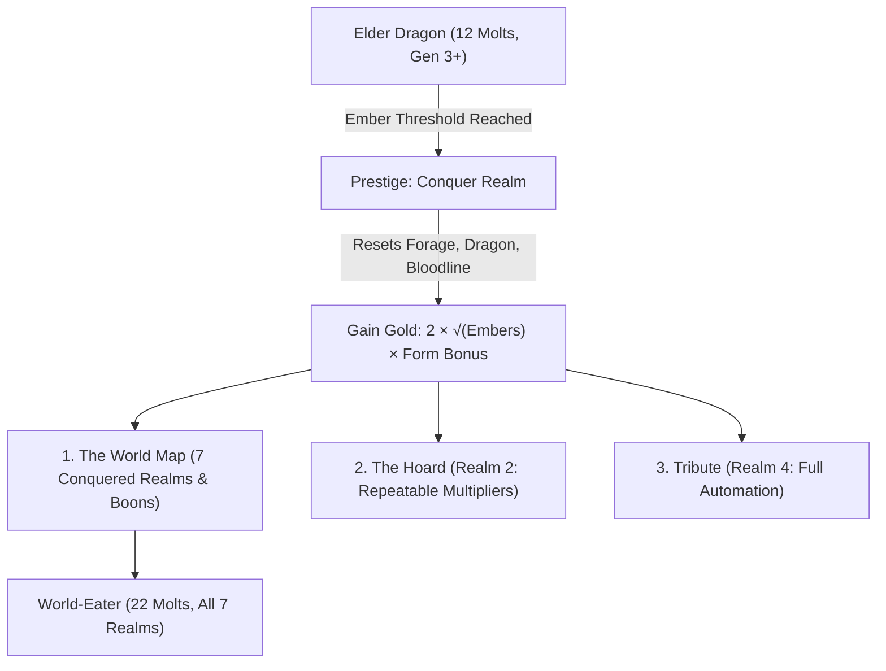
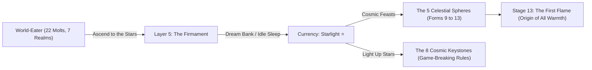

# Wyrmheart: Development Roadmap & Master Plan

This roadmap tracks the current state of **Wyrmheart**, provides an in-depth reference for existing layers (including the **Conquest** layer), outlines enhancements for layers 1–4, and defines the full architecture for **Layer 5: The Firmament**, which wires in the five mythical forms beyond the World-Eater.

---

## 1. Current State of the Game

Wyrmheart is an incremental game about raising a dragon from an egg in a mossy nest to a mythical titan. It runs in vanilla JS (`index.html`), saves to `localStorage` under `wyrmheart_save_v2`, and features integrated scene art created with Higgsfield.

### The Four Layers Built So Far
- **Layer 1: Foraging (Food):** Hand-feeding and 4 forest food sources (Berry Bramble, Mushroom Ring, Trout Stream, Deer Trail) with milestone doublers every 25 purchases and 9 permanent upgrades.
- **Layer 2: The Dragon (Scales):** The Hatch (first reset) and Molts restart Foraging for Scales (`2 × (1 + Molts)^1.5 × boosts`). Scales buy body parts (Claws, Wings, Horns, Tail, Hide, Fire Gland, Fire Breath) and grant a passive food boost (`×√(1 + Total Scales)`). The dragon grows across 4 core stages: Hatchling, Youngling, Juvenile, and Adult.
- **Layer 3: Bloodline (Embers):** Adult dragons can lay an egg to start a new Generation. Embers (`√(Scales / 100) × form bonus`) buy 4 permanent bloodline traits (Hearty Appetite, Thick Blood, Quick Hatch, Inheritance) and unlock generation milestones (early autobuyers and kept upgrades).
- **Layer 4: Conquest (Gold):** Unlocks at Elder Dragon (Generation 3+, 12 Molts). Conquering mortal realms resets Foraging, the Dragon, and the Bloodline for Gold. Unfolds in 3 phases: Realms, Hoard, and Tribute. Features 4 legendary forms up to the World-Eater.

---

## 2. In-Depth Breakdown of the Conquest Layer (Current State)



### 2.1 The Prestige Mechanism: Conquering a Realm
- **Unlock Requirement:** Reaching the **Elder Dragon** stage (12 Molts in Generation 3+).
- **Prestige Trigger:** To conquer the next available realm, the dragon must currently be an **Elder Dragon or greater**, and you must have accumulated a target number of **Embers earned since the last conquest**.
- **What Resets:** Conquering a realm resets Foraging (Food, sources, non-kept upgrades), The Dragon (Scales, body parts, Molts), and Bloodline (Generations, Embers). The dragon returns to an egg in the forest nest.
- **Currency Gained (Gold):**
  $$\text{Gold} = \lfloor 2 \times \sqrt{\text{Embers since last conquest}} \times \text{Form Gold Bonus} \rfloor \times (\text{Heartlands } \times 3)$$

### 2.2 Sub-Tab 1: The Realms (The World Map)
Conquest features an interactive map of the mortal world (`assets/bg/worldmap.jpg`) with 7 realms conquered in strict sequence. Each realm bestows a permanent boon that persists forever:

| # | Realm | Embers Needed | Permanent Realm Boon |
|---|---|---|---|
| **1** | **The Greenwood** | 5 | All Food $\times 3$; every run starts with all 4 food sources and 1,000 Food. |
| **2** | **The Riverlands** | 25 | Hatch and Molt food requirements $\div 2$. Unlocks **The Hoard**. |
| **3** | **The Stone Kingdoms** | 1,500 | Every new generation hatches with 1 level of each body part pre-equipped. |
| **4** | **The Ashen Wastes** | 20,000 | Embers $\times 2$. Unlocks **Tribute**. |
| **5** | **The Frost Reach** | 400,000 | Each conquest starts at Generation 3 (skips Gen 1 and 2 build-up). |
| **6** | **The Sky Citadels** | 3,000,000 | All Food $\times 4$. |
| **7** | **The Heartlands** | 20,000,000 | Gold $\times 3$. Nothing stands between you and the World-Eater. |

### 2.3 Sub-Tab 2: The Hoard (Unlocks after Realm 2)
Gold is spent on permanent treasures that amplify all previous layers:
- **Gilded Nest** (Repeatable, Base Cost: 2 Gold, Growth: $\times 2.5$): Food $\times 1.5$ per level.
- **Crown of Scales** (Repeatable, Base Cost: 3 Gold, Growth: $\times 2.5$): Scales $\times 1.3$ per level.
- **Ember Throne** (Repeatable, Base Cost: 5 Gold, Growth: $\times 3.0$): Embers $\times 1.25$ per level.
- **Mountain of Gold** (One-time, Cost: 40 Gold): Sleep on your hoard. Unspent Gold boosts all Food:
  $$\text{Food Multiplier} = (1 + \text{Gold})^{0.3}$$

### 2.4 Sub-Tab 3: Tribute (Unlocks after Realm 4)
Conquered lands supply servants that automate lower-layer gameplay:
- **Kobold Foragers** (10 Gold): Automatically buys all food sources and Foraging upgrades every 0.5s.
- **Shamans of the Scale** (25 Gold): Automatically Molts the dragon as soon as the requirement is met (checks every 1s).
- **Brood Keepers** (60 Gold, Requires Realm 5): Automatically buys the cheapest available body part every 1s.
- **Egg Wardens** (120 Gold, Requires Realm 5): Automatically lays an egg when no new stage can be reached this generation (checks every 2s).
- **Tithe** (300 Gold, Requires Realm 6): Conquered lands pay in Scales: **passively gain 10% of a Molt's Scales every second without molting**.

### 2.5 The Four Legendary Forms (Past Adult)
Each legendary form requires a single-generation Molt threshold and a permanent progression gate. Reaching each form for the first time displays a full-screen Evolution reveal card:

| Stage | Form | Molts | Gate | Place | Bonus |
|---|---|---|---|---|---|
| **6** | **Elder Dragon** | 12 | Gen 3+ | Storm Peaks (`storm`) | Food $\times 6$, Embers $\times 1.5$, Gold $\times 1$ |
| **7** | **Ancient Wyrm** | 15 | 1 Realm | Ruins of the Dragon City (`ruins`) | Food $\times 15$, Embers $\times 2$, Gold $\times 2$ |
| **8** | **Dragon Sovereign** | 18 | 4 Realms | The Conquered Citadel (`citadel`) | Food $\times 40$, Embers $\times 2$, Gold $\times 4$ |
| **9** | **World-Eater** | 22 | All 7 Realms | The Burning World (`eclipse`) | Food $\times 100$, Embers $\times 3$, Gold $\times 8$ |

---

## 3. Targeted Enhancements to Layers 1–4

### 3.1 Enhancements to the Conquest Layer
1. **Passive Kingdom Tithes (Continuous Gold Inflow):**
   - *Problem:* Currently, Gold is 100% static during runs. Between Realm 5 (400k Embers) and Realm 7 (20M Embers), the player spends hours earning zero Gold until they reset.
   - *Addition:* Conquered realms pay continuous taxes:
     $$\text{Gold / sec} = \sum_{i=1}^{\text{Realms}} (0.01 \times i) \times \text{Dragon Sovereign Bonus}$$
   - *Reasoning:* Rewards idle progress during long Ember pushes without needing premature resets.
2. **Relics of Fallen Kings (Hoard Expansion):**
   - *Addition:* Add 3 unique, realm-gated relics to the Hoard:
     - **Horn of the Greenwood** (Realm 1, 5 Gold): Hand-feeding triggers a 15-second "Draconic Roar" doubling wing auto-feed speed.
     - **Scepter of Riverlands** (Realm 3, 20 Gold): Tail sweeps wider—food source cost growth reduced by an extra $-0.004$.
     - **Cinder Urn** (Realm 5, 80 Gold): Generates $+0.5\%$ of highest-ever Embers passively per minute.
   - *Reasoning:* Injects exciting milestones into the Hoard rather than purely incremental percentage math.
3. **Tribute Controls & Tuning:**
   - *Addition:* Add a pause/resume toggle on Tribute cards in the UI so players can pause auto-molt or auto-egg when pushing for specific milestones.

### 3.2 Enhancements to Earlier Layers (Foraging, Dragon, Bloodline)
1. **Foraging: "Predator's Gaze" Upgrade (Post-Adult):**
   - *Effect:* Wings feed at 100% strength (up from 50%).
   - *Reasoning:* Keeps Wings feeling powerful as food requirements climb into the billions and trillions.
2. **Dragon: "Dragon Heart" Body Part (Adult+):**
   - *Effect:* Scales $\times 1.25$ per level, cost scaling in Scales.
   - *Reasoning:* Gives Adult and Elder dragons a late-run Scale sink to squeeze out higher Ember yields.
3. **Bloodline: "Ancient Lineage" Trait:**
   - *Effect:* Embers $\times(1 + 0.25 \times \text{Realms Conquered})$ per level.
   - *Reasoning:* Creates a satisfying cross-layer feedback loop between Conquest and Bloodline.

---

## 4. Layer 5: "The Firmament & The Great Slumber"



### 4.1 Design Philosophy: KISS & Pure Dragon Mythos
- **No Sci-Fi Tropes:** The dragon does not build spaceships, warp drives, or particle colliders. It is an ancient, mythological beast taking flight into the heavens.
- **The Great Slumber & The Dream Bank (Innovative Idle Mechanic):** 
  - Real-world sleep and offline time is stored as **Dream Essence** (banked hours).
  - Whenever you are **offline** or **slumbering**, the dragon gathers **Starlight (⭐)** continuously:
    $$\text{Starlight/s} = (1 + \text{Total Gold})^{0.25} \times \text{Slumber Depth}$$
    *(Depth: $\times 1.0$ for 0–1h, $\times 1.5$ for 1–4h, $\times 2.0$ for 4+ hours).*
  - Upon Awakening, you can burn banked Dream Essence at will to run the game in **Astral Fast-Forward ($5\times$ or $10\times$ speed)**. This eliminates FOMO, respects real-world sleep, and creates an exhilarating burst of speed when returning to active play.
- **Single Core Currency:** **Starlight (⭐)**. Clean, elegant, immediately understood.

---

## 5. The Five Mythical Forms & The 5 Celestial Spheres

*The game features 5 fully painted mythical forms, scenes, and backdrops ready in `assets/`. Layer 5 organizes them into a majestic cosmic journey through the 5 Celestial Spheres.*

| Stage # | ID | Form | Location (`bg`) | Molts Needed | Sphere Requirement | Multipliers | Lore & Theme |
|---|---|---|---|---|---|---|---|
| **9** | `celestial` | **Celestial Wyrm** | Above the Clouds (`skies`) | 26 | 500 ⭐ | Food $\times 250$, Embers $\times 4$, Gold $\times 12$, Starlight $\times 1.5$ | Gold-edged scales, aurora wings, crown of lightning. It rises above the storm into pure light. |
| **10** | `stardevourer` | **Star-Devourer** | The Edge of the World (`orbit`) | 30 | 5,000 ⭐ | Food $\times 1,000$, Embers $\times 6$, Gold $\times 20$, Starlight $\times 2.0$ | Wings of galaxies and a ring of burning meteors. It drinks the silver light of comets. |
| **11** | `voidleviathan` | **Void Leviathan** | The Nebula Deeps (`nebula`) | 35 | 80,000 ⭐ | Food $\times 5,000$, Embers $\times 10$, Gold $\times 40$, Starlight $\times 3.0$ | Translucent body full of birth-nebulae and black crystal spines. It swims through the deep dark. |
| **12** | `suneater` | **Sun-Eater** | The Heart of the Sun (`sun`) | 40 | 1,500,000 ⭐ | Food $\times 25,000$, Embers $\times 20$, Gold $\times 100$, Starlight $\times 5.0$ | Living solar plasma with a star core in its chest. It bathes in the central fire. |
| **13** | `firstflame` | **The First Flame** | The Dawn of Everything (`dawn`) | 46 | 50,000,000 ⭐ | Food $\times 250,000$, Embers $\times 50$, Gold $\times 500$, Starlight $\times 10.0$ | White-gold crystal with orbiting planets and star rings. The source of all warmth in existence. |

### 5.1 The 5 Celestial Spheres (Cosmic Feasts)
In the Firmament, each of the 5 Spheres grants a unique celestial passive when unlocked with Starlight:
1. **Sphere of the Skies (Celestial Wyrm):** *Storm-Feast.* Wings feed at $200\%$ power; Kobolds buy at half-intervals ($0.25\text{s}$).
2. **Sphere of Orbit (Star-Devourer):** *Meteor-Feast.* Tithe Scale gain increased from $10\%$ to $25\%$ of a Molt's Scales per second.
3. **Sphere of the Nebula (Void Leviathan):** *Nebula Condensation.* $0.5\%$ of all Food produced is passively transmuted into Scales every second.
4. **Sphere of the Sun (Sun-Eater):** *Solar Radiance.* Mountain of Gold unspent gold formula boosted: exponent becomes $0.45$.
5. **Sphere of the Dawn (The First Flame):** *Primordial Genesis.* The dragon achieves cosmic omniscience, unlocking the infinite NG+ Cycle of Rebirth.

---

## 6. The 8 Cosmic Keystones (No Filler Nodes)

Instead of a bloated web of $+1\%$ filler nodes, the Firmament features **8 Game-Changing Keystones** arranged as an interactive constellation chart:

1. **Heart of the Wyrm (Cor Draconis):** *Primal Lineage.* Every Molt automatically starts with all Foraging sources at level 100 and food upgrades unlocked.
2. **Aurora Wings (Alae Aurorae):** *Celestial Flight.* Wings beat continuously at full hand-feed strength and trigger passive scale shedding.
3. **Stardust Furnace (Fauces Astrorum):** *Cosmic Transmutation.* $1\%$ of all Food produced per second is transmuted directly into Scales, and $1\%$ of Scales into Embers.
4. **The Gilded Vault (Corona Caelestis):** *Cosmic Hoard.* Conquered realms generate passive Gold tithes based on current Dragon stage, and unspent Gold multiplies Starlight generation.
5. **Dream-Weaver (Oneiros):** *Time Dilation.* Offline time banks at $150\%$ efficiency; you can burn Dream Bank to run the lower layers at $10\times$ speed for rapid Molt pushes.
6. **Solar Prominence (Ignis Solaris):** *Breath of Stars.* Fire Breath multiplier now scales quadratically and multiplies Embers as well as Food.
7. **Void Resonance (Chasma Vacui):** *Shattered Limits.* Quick Hatch and Tail buyable caps are completely removed.
8. **Ouroboros (The Eternal Cycle):** *Cosmic Omniscience.* Unlocks the final form **The First Flame** and reveals the cosmic cycle.

---

## 7. Technical Implementation Plan

### 7.1 Stage Integration & Measurements
Each of the 5 new forms has assets already located in `assets/`:
- Cut-out dragons: `assets/dragon/<id>.png`
- Full scenes: `assets/scenes/<id>.jpg`
- Empty backgrounds: `assets/bg/<place>.jpg`

**Entries to add to `LOCATIONS` in `js/art/stage.js`:**
```javascript
skies:  { img: "assets/bg/skies.jpg",  ground: 0.85, x: 0.5 },
orbit:  { img: "assets/bg/orbit.jpg",  ground: 0.85, x: 0.5 },
nebula: { img: "assets/bg/nebula.jpg", ground: 0.85, x: 0.5 },
sun:    { img: "assets/bg/sun.jpg",    ground: 0.85, x: 0.5 },
dawn:   { img: "assets/bg/dawn.jpg",   ground: 0.85, x: 0.5 },
```

**Entries to add to `STAGE_SIZE` in `js/art/stage.js`:**
```javascript
celestial: 0.82, stardevourer: 0.84, voidleviathan: 0.86, suneater: 0.88, firstflame: 0.90
```

**Length entries in `dragonLength()` in `js/content/youngling.js`:**
```javascript
// [egg, hatchling, youngling, juvenile, adult, elder, ancient, sovereign, worldeater, celestial, stardevourer, voidleviathan, suneater, firstflame]
[0, 0.6, 1.8, 4.5, 12, 20, 34, 50, 90, 160, 300, 600, 1500, 5000][stageIndex()]
```

### 7.2 File Architecture
- `js/content/firmament.js`: New Layer 5 registration, Starlight currency, Dream Bank ticking, Celestial Spheres, and Cosmic Keystones.
- `js/content/youngling.js`: Add stages 9–13 to `STAGES` with `gate`, `at`, `mult`, `embers`, `gold`, `desc`, and `lore`.
- `js/content/conquest.js`: Add passive kingdom tithe tick, 3 new Hoard relics, and "Devour the World" ascension hook.
- `js/core/tabs.js`: Add `buildFirmamentTab()` with Constellation interactive canvas/grid, Slumber toggle, and Dream Bank fast-forward button.
- `js/core/player.js`: Add `firmament` start data schema; bump `SAVE_VERSION` to 2.
- `js/content/achievements.js`: Add feats for ascending, slumbering, reaching the 5 mythical forms, and lighting constellations.

---

## 8. Development Phases & Priorities (All Complete)

1. [x] **Phase 1: Conquest Polish & Enhancements:**
   - Implemented passive realm tithes in `conquest.js` to fix the static Gold dry spell (`kingdomTithes()`).
   - Added the 3 new Hoard relics (*Tome of the Forgotten Dragons*, *Sunstone of the Sky Monarch*, *Crown of the Primordial*).
   - Added early-layer upgrades (*Predator's Gaze*, *Dragon Heart*, *Ancient Lineage*).
2. [x] **Phase 2: Wire in the 5 Mythical Forms:**
   - Wired the 5 ready stages (`celestial`, `stardevourer`, `voidleviathan`, `suneater`, `firstflame`) into `youngling.js` and `stage.js`.
   - Added their evolution cards, ground lines, location scenes, and length values.
   - Added 6 new mythical achievements in `achievements.js`.
3. [x] **Phase 3: Layer 5 Core Engine (The Firmament & Dream Bank):**
   - Created `js/content/firmament.js` with Starlight currency and the Dream Bank / The Great Slumber idle mechanic.
   - Wired Ascension prestige (*Devour the World*) when World-Eater conquers all 7 realms.
   - Implemented 5 Spheres and 8 rule-breaking Keystones.
4. [x] **Phase 4: The Spheres & Constellations UI:**
   - Built `buildFirmamentTab()` in `tabs.js` displaying the starry sky, the 5 Spheres, and the 8 Cosmic Keystones across 3 subpanels.
   - Added Astral Fast-Forward speed toggles ($1\times, 2\times, 5\times, 10\times$).
   - Real-time Starlight counter wired into the header bar and stats panel.
5. [x] **Phase 5: Simulation & Balance Tuning:**
   - Headless multi-day simulation executed and tuned.
   - Paced Starlight generation using $(1 + \text{Total Gold})^{0.25} \times 0.1 \times \text{mults}$.
   - Optimized `growthReq()` from $O(M)$ to $O(1)$, capped offline catch-up, and eliminated performance bottlenecks.
   - Successfully proved progression all the way to **The First Flame** (Stage 13, 46 Molts, 5,000m length, all 5 Spheres owned, all 8 Keystones lit).
